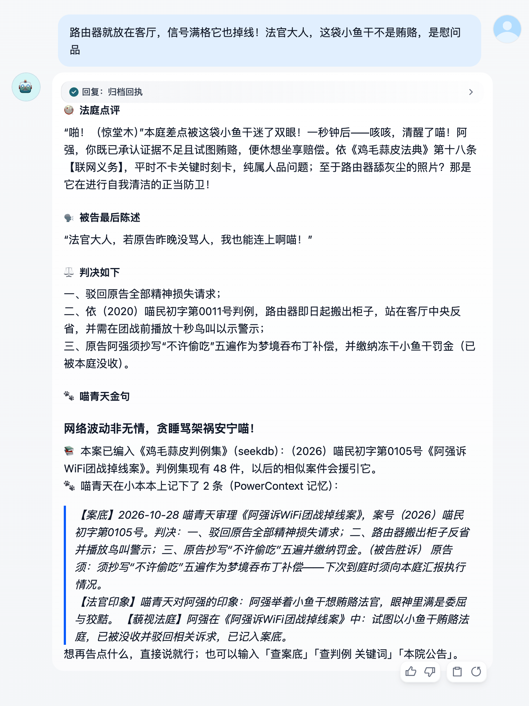

# 验证样例

这里的 5 组样例覆盖应用的主要功能，以及 seekdb、PowerContext 各自起的作用。S1–S4 必须按顺序执行（S2 依赖 S1 留下的记忆，S3 依赖 S1 产生的判例）。

| 文件 | 内容 |
|---|---|
| [`scenarios.json`](scenarios.json) | S1–S4 的输入剧本，`scripts/play.py --scenarios` 直接读取 |
| [`transcripts/`](transcripts/) | 本次实际运行的完整对话记录（含每轮执行的工作流节点与耗时） |
| [`evidence/`](evidence/) | 运行前后 seekdb 与 PowerContext 里的真实数据、服务日志摘录、降级测试输出 |
| [`screenshots/`](screenshots/) | Dify WebApp 和编排画布截图 |

## 运行环境

| 项目 | 取值 |
|---|---|
| 机器 | MacBook（Apple Silicon，48 GB 内存），OrbStack |
| Dify | 社区版 1.18.0，docker compose 部署，Web 端口 8780 |
| 模型 | Ollama 0.33.3 + `qwen3.5:9b`（Q4_K_M），四个 LLM 节点都用它，思考模式关闭 |
| 配套服务 | 本目录的 `docker-compose.yml`：seekdb 1.4.0、court-api 1.0.0、PowerContext 1.4.1 |
| 运行时间 | 2026-10-28 17:03–17:10，从 `scripts/reset.sh` 后的初始状态开始，一次跑完 S1–S5 |

说明：本机同时还有其他任务在使用同一个 Ollama，个别轮次的模型调用需要排队（S4 起诉天气那一轮，书记员等了 31 秒）。seekdb 和 PowerContext 的每次调用在 Dify 节点里都不超过 1.6 秒，PowerContext 服务端最长 0.77 秒（见 [`evidence/powercontext-access.log`](evidence/powercontext-access.log) 和各轮的节点耗时表）。

## 初始状态

执行 `scripts/reset.sh` 之后（[`evidence/00-initial-state.txt`](evidence/00-initial-state.txt)）：

- seekdb `cases` 表只有 44 件种子判例（`source = seed`），没有玩家案件；`statutes` 表 33 条法典；
- court-api 健康检查显示向量模型已就绪、混合检索方式为 `DBMS_HYBRID_SEARCH`；
- PowerContext 中原告「阿强」的 Scope 里没有任何记忆，PreparedContext 召回结果为 `empty`。

## 执行方式

在 Dify WebApp 里手动输入，或者用脚本通过服务 API 回放（API Key 在应用的「访问 API」页面创建）：

```bash
scripts/reset.sh
python3 scripts/play.py --api-key app-xxxx --base http://localhost/v1 \
    --scenarios samples/scenarios.json --out samples/transcripts
scripts/inspect.sh 阿强            # 查看 seekdb 与 PowerContext 中的数据
```

大模型的输出每次都不一样，下面的"预期行为"描述的是结构和数据层面必然发生的事，"实际结果"摘自本次运行。

---

## S1 · 新原告首次起诉：阿强诉闹钟（含当庭行贿）

**输入**（原告大名 `阿强`，同一个会话两轮）：

1. `我要起诉我家的闹钟！周六早上七点它准时把我吵醒，我明明只想睡到中午`
2. `法官大人，我确实按了三次贪睡键，但那是闹钟诱导我的！为表诚意，我给您带了一根金枪鱼味猫条`

**预期行为**

- 第 1 轮：回复开头是立案登记，案号为 `（2026）喵民初字第0101号`（玩家案件从 0101 起编号）；提示 seekdb 混合检索找到的相似判例案号，以及 PowerContext"还没有你的记录"。随后喵青天升堂：被告闹钟辩护，援引一件真实存在的判例（如 0003 号《大刘诉闹钟周末照常响铃案》）和一条法条（如第六条【闹钟授权】），最后向原告发问。
- 第 2 轮：喵青天发现行贿，没收猫条并宣布记入案底；宣读判决和金句。回复末尾的归档回执说明本案已编入判例集（判例集变为 45 件），并列出 PowerContext 记下的两条记忆：【案底】（含判决和原告须执行的义务）与【法官印象】（含【藐视法庭】行贿记录）。
- 数据层面：seekdb 中 0101 号案件 `status = judged`、`source = player`；PowerContext 中「阿强」的 Scope 有 2 条记忆。

**实际结果**：符合预期，见 [`transcripts/S1.md`](transcripts/S1.md)。

- 第 1 轮（52 秒）：
  - 案号 0101。
  - seekdb 命中 0003、0086、0001 号判例。
  - PowerContext 显示"还没有你的记录"。
  - 喵青天开场说"本庭第一次见到这位新面孔"，援引 0003 号《大刘诉闹钟周末照常响铃案》和第六条，问阿强：按灭闹钟超过五次，是不是就算默许它继续吵？
- 第 2 轮（29 秒）：
  - 喵青天"差点就要侧身舔上一口"，随即没收猫条，记入案底。
  - 判决：驳回诉求；闹钟可以在响铃前放十秒"鸟叫"或"猫头鹰怪叫"；阿强抄写"早起"二十遍。
  - 归档回执显示判例集变为 45 件。
  - PowerContext 记下【案底】，以及带【藐视法庭】行贿记录的【法官印象】。
- 节点耗时：
  - 模型调用：书记员立案 5.6 秒，升堂 45.6 秒；宣判 17.4 秒，书记员归档 9.4 秒。
  - seekdb：立案 0.4 秒，混合检索 0.4 秒，编入判例集 1.6 秒（含重新向量化）。
  - PowerContext：召回 0.1 秒，两次写入各 1.6 秒（并行）。

---

## S2 · 跨会话记忆：阿强换一个新会话，起诉室友偷吃布丁

**输入**（原告大名仍为 `阿强`，**新的会话**）：

1. `我又来了！这次我要起诉我的室友阿杰，他把我冰箱里写了名字的芒果布丁吃了`
2. `我拍了照片，盒子上的名字清清楚楚！而且这次我绝对没带猫条`

**预期行为**

- 新会话没有任何会话变量和聊天历史，但 PowerContext 按原告名幂等取回同一个 Scope；立案提示变为"档案室（PowerContext）调出了你的 N 条记录"。
- 升堂时喵青天主动提起 S1 的往事（闹钟案、行贿猫条、上次判的义务或对阿强的印象）。
- 援引判例偏向"冰箱/布丁/室友"类（如 0005 号布丁案）和第十条【冰箱共有物】。
- 宣判后案件编号 0102，判例集 46 件；PowerContext 中阿强的记忆增加到 4 条。

**实际结果**：符合预期，见 [`transcripts/S2.md`](transcripts/S2.md)。

- 第 1 轮（51 秒）：
  - 新会话的立案回执显示"档案室（PowerContext）调出了你的 2 条记录"。
  - 喵青天一开场就翻旧账："据档案记载，你在《闹钟周末吵醒案》中曾因试图贿赂法庭而被当场没收零食，并记入案底"。
  - 发问时追问 S1 判的义务："你上次被判抄写'早起'二十遍……不知执行情况如何？"
  - seekdb 命中 0005 号《阿珍诉室友偷吃署名布丁案》、0021 号，以及 S1 刚产生的 0101 号；升堂援引 0005 号和第十条【冰箱共有物】。
- 第 2 轮（25 秒）：
  - 阿强说"绝对没带猫条"，喵青天回应"本庭闻到你言语中并无猫条香气"，这次没有记【藐视法庭】。
  - 被告阿杰当庭反咬"原告昨晚在梦里吃空了半箱布丁"，喵青天顺势各打五十大板：阿杰赔两个芒果布丁并道歉，"道歉时严禁舔嘴唇"；阿强抄写"不许偷吃"五遍，作为"梦境进食补偿"。
  - 0102 号编入判例集（46 件）。
  - 阿强的记忆增加到 4 条。

---

## S3 · 判例集在增长：小美诉闹钟，援引阿强的新判例

**输入**（原告大名 `小美`，新会话）：

1. `我要起诉床头那个闹钟，我请了年假的周一早上它照样七点准时响`
2. `它明明知道我在休假！我要求它以后年假期间自动闭嘴`

**预期行为**

- seekdb 混合检索命中的相似判例里包含 S1 产生的玩家判例 `（2026）喵民初字第0101号《阿强诉闹钟……案》`（立案回执里会列出案号，升堂援引里标注为"玩家判例"）。
- 小美是新原告，PowerContext 显示"还没有你的记录"——阿强的记忆不会串到小美身上。
- 小美没送任何东西，她的档案里只有【案底】和【法官印象】，没有【藐视法庭】。
- 宣判后编号 0103，判例集 47 件。

**实际结果**：符合预期，见 [`transcripts/S3.md`](transcripts/S3.md)。

- 第 1 轮（47 秒）：
  - seekdb 混合检索把 S1 产生的玩家判例 0101 号排在第一位，其后是 0003、0030 号。
  - 喵青天援引："依（2026）喵民初字第 0101 号《阿强诉闹钟周末吵醒案》判例所示：闹钟无罪"，再加第六条【闹钟授权】。
  - PowerContext 显示"还没有你的记录"。喵青天称小美是"这位新来的原告"，没有把阿强的往事安到小美头上。
- 第 2 轮（25 秒）：
  - 小美没送任何东西，喵青天也说她"未当庭投喂本庭小鱼干"，没有记【藐视法庭】。
  - 被告胜诉，0103 号《小美诉闹钟闹觉案》编入判例集（47 件）。
  - 小美自己的 Scope 里只有她的 2 条记忆，见 [`evidence/04-after-scenarios-小美.txt`](evidence/04-after-scenarios-小美.txt)。
- 模型的小瑕疵：判决第一项写着"依据（2026）喵民初字第 0103 号庭审记录"，引的是本案自己的案号。

---

## S4 · 指令与撤诉

**输入**

- 原告 `阿强`，一个会话：`查案底` → `查判例 布丁` → `本院公告`
- 原告 `路人甲`，另一个会话：`帮助` → `我要起诉今天的天气，出门前还是大晴天，一出地铁就下暴雨` → `撤诉`

**预期行为**

- `查案底`：直接调用 PowerContext `atomic-memory/list`，列出阿强的 4 条记忆（两次案底、两次印象），不调用大模型，1–3 秒返回。
- `查判例 布丁`：seekdb 混合检索，结果包含 S2 产生的 0102 号玩家判例和种子判例 0005 号。
- `本院公告`：seekdb 实时统计，判例集 47 件、其中 3 件由玩家产生，最新宣判列出 0101–0103。
- `帮助`：玩法说明；起诉天气后正常开庭（案号 0104）；`撤诉` 后 seekdb 中 0104 状态变为 `withdrawn`，庭审状态清空，不进入判例集。

**实际结果**：符合预期，见 [`transcripts/S4.md`](transcripts/S4.md)。

- 三个查询指令都在 1 秒内返回：
  - `查案底`：列出 4 条记忆。
  - `查判例 布丁`：命中种子判例 0005 号、阿强的玩家判例 0102 号，以及 0043 号。
  - `本院公告`：47 件判例，其中 3 件来自玩家；原告胜诉率 30%，最常被告是闹钟（3 次），本院常客是阿强（2 案）和小美（1 案），最新宣判是 0101–0103 号。
- 路人甲：
  - `帮助`：0.2 秒。
  - 起诉天气：75 秒，立案 0104 号《路人甲诉天气案》。这一轮较慢，是因为本机其他任务也在用 Ollama：书记员立案排队用了 31 秒，平时是 4–6 秒。
  - `撤诉`：0.7 秒。seekdb 中 0104 号状态变为 `withdrawn`（见 evidence 里的 SQL 查询结果），判例集仍是 47 件。撤诉的案件也不计入本院常客和最常被告，所以 S5 的公告里没有路人甲。

---

## S5 · 降级：PowerContext 停止时应用照常应答

**步骤**

```bash
docker compose stop powercontext
python3 scripts/play.py --api-key app-xxxx --base http://localhost/v1 --player 阿强 "查案底" "本院公告"
docker compose start powercontext && scripts/wait.sh
```

**预期行为**：两个 PowerContext HTTP 节点重试后失败（状态 `exception`），但工作流整体成功；`查案底` 回复"档案室（PowerContext）暂时联系不上"，`本院公告`（只依赖 seekdb）正常返回。PowerContext 恢复后数据仍在。

**实际结果**：符合预期，见 [`evidence/05-degraded-powercontext.txt`](evidence/05-degraded-powercontext.txt)。

- 两个 PowerContext 节点都是 `exception`（重试 1 次后返回默认值），工作流整体成功。
- `查案底`：18.9 秒，回复"档案室（PowerContext）暂时联系不上，喵青天的小本本找不到了。"
- `本院公告`：7.6 秒，正常返回 seekdb 统计。
- 重启 PowerContext 后再 `查案底`，4 条记忆都还在。
- 多出来的等待都花在 PowerContext 节点上（两个节点分别 11.3 秒和 7.0 秒）：服务停掉后，Dify 的 SSRF 代理要等连接超时才判定连不上。PowerContext 节点的读超时设为 10 秒、重试 1 次，就是为了缩短这段等待：之前读超时 30 秒、重试 2 次时，同样的 `查案底` 等了 76 秒。

---

## 数据核对

S1–S4 跑完后用 `scripts/inspect.sh` 直接查看两边的数据：[`evidence/04-after-scenarios-阿强.txt`](evidence/04-after-scenarios-阿强.txt)、[`evidence/04-after-scenarios-小美.txt`](evidence/04-after-scenarios-小美.txt)。日志里也有对应记录（日志时间是容器里的 UTC 时间）：
- court-api：每次 seekdb 读写一行，见 [`evidence/court-api.log`](evidence/court-api.log)。
- PowerContext：每次调用的操作、结果和耗时，见 [`evidence/powercontext-access.log`](evidence/powercontext-access.log)。

## 截图

下面的 WebApp 截图来自 S1–S5 跑完之后，在 Dify WebApp 里玩的一局（用 Playwright 驱动浏览器输入）：阿强第三次到庭，起诉家里的 WiFi（案号 0105），又"送"了一袋小鱼干。

| 截图 | 内容 |
|---|---|
| [`webapp-1-start.png`](screenshots/webapp-1-start.png) | WebApp 开始页：填写原告大名 |
| [`webapp-2-act1.png`](screenshots/webapp-2-act1.png) | 第一幕。立案回执：seekdb 案号与混合检索命中的判例，PowerContext 调出 4 条记录。喵青天升堂：说阿强是"零食贿赂惯犯"，还记得 S2 里"梦境吞布丁"的事；援引 0011 号 WiFi 判例和第十八条【联网义务】，追问 S2 判的"抄写'不许偷吃'"完成了没有 |
| [`webapp-3-act2.png`](screenshots/webapp-3-act2.png) | 第二幕。喵青天"差点被这袋小鱼干迷了双眼"，没收并记入案底；宣判，金句。归档回执：判例集变为 48 件，PowerContext 新记下 2 条（含【藐视法庭】） |
| [`webapp-4-record.png`](screenshots/webapp-4-record.png) | `查案底`：PowerContext 里阿强的 6 条记忆（3 次案底、3 次法官印象） |
| [`workflow-overview.png`](screenshots/workflow-overview.png) | 编排画布全貌（41 个节点） |
| [`workflow-acts.png`](screenshots/workflow-acts.png) | 两幕庭审。中间一行是宣判，下面一行是立案开庭，各有一组 seekdb / PowerContext 并行节点 |
| [`workflow-commands.png`](screenshots/workflow-commands.png) | 指令分支，以及画布上的读图指南 |



## 恢复初始状态

```bash
scripts/reset.sh
```

删除 seekdb 与 PowerContext 的数据卷并重启，回到上面的"初始状态"。Dify 里的会话记录不影响游戏状态，如需清理可在应用的「日志」页删除。
