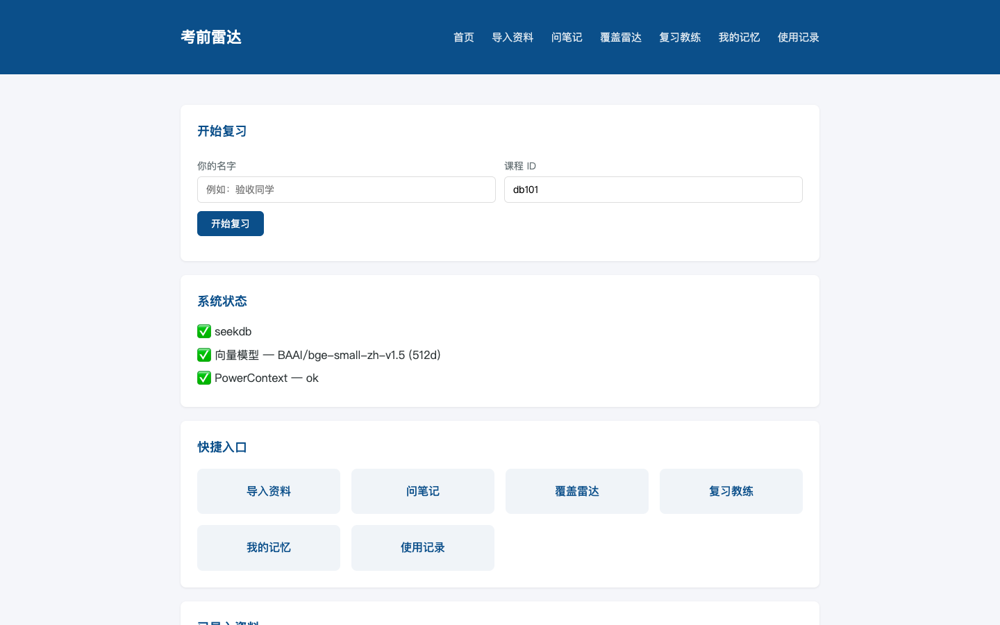
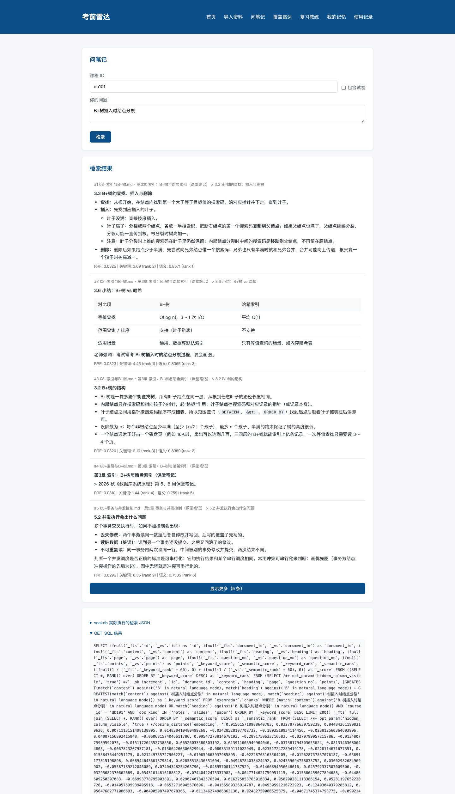
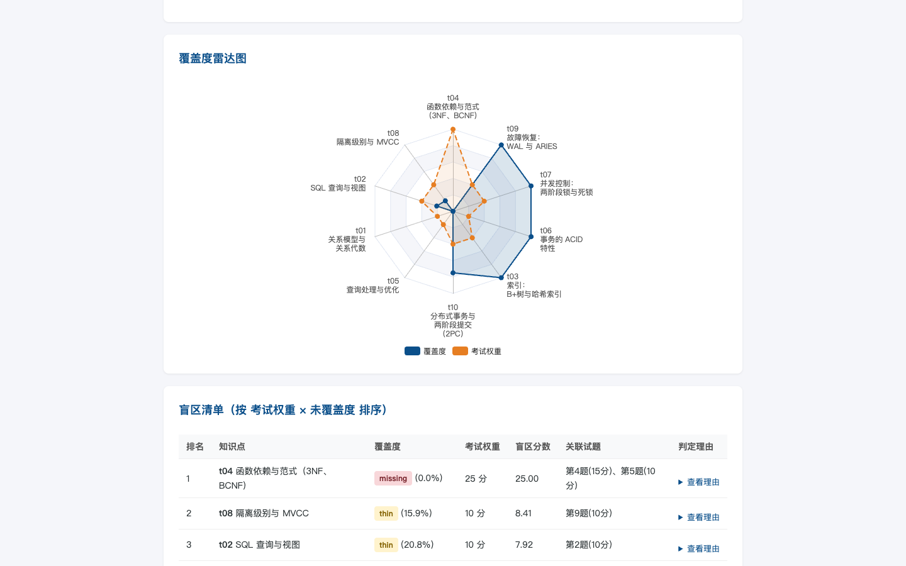
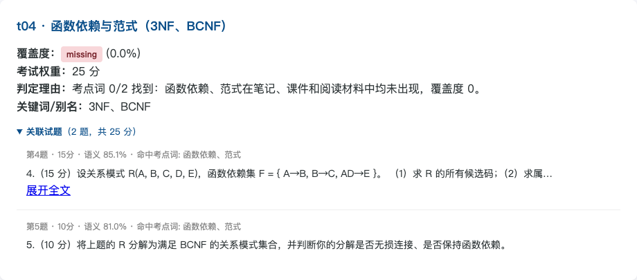
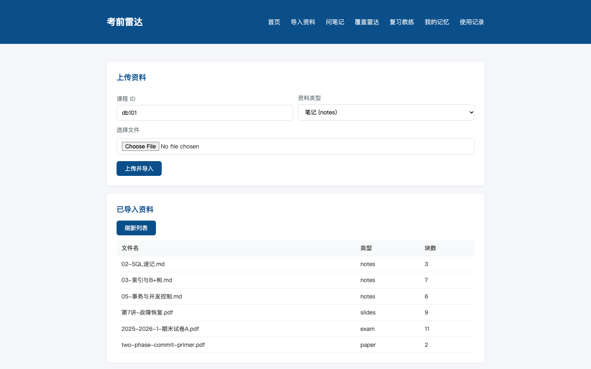
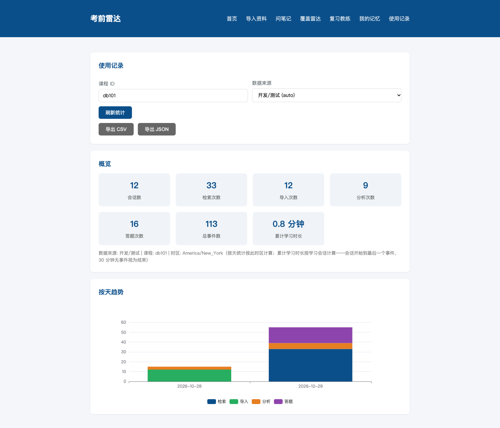
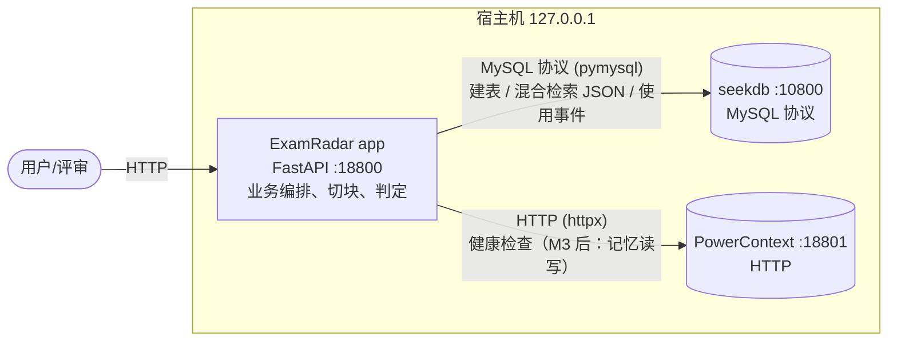

# ExamRadar 考前雷达

**一句话**：ExamRadar 把期末前零散的课程资料（笔记、课件、往年试卷、阅读材料）变成一个可检索、可量化"复习覆盖度"的知识库——问笔记有出处，考前一眼看清"笔记没记到、但往年试卷分值很高"的盲区。

## 解决什么问题

期末复习时，学生手里的资料是零散的：笔记记得有的全有的缺、课件一摞 PDF、往年试卷不知道考什么。
常见痛点：

- 想查一个概念，翻 PDF 太慢，普通全文搜索又搜不到"意思相近但用词不同"的段落；
- 不知道自己记的笔记**相对于考试范围**缺什么——尤其那些"试卷占分很高、笔记一个字没写"的知识点；
- 复习了几次、效果如何，没有记录。

ExamRadar 用 seekdb 的**混合检索**（BM25 关键词 + 向量语义，RRF 融合，全部在数据库内完成）解决第一个问题；
用**考点词证据判定** + 往年试卷分值统计解决第二个问题（覆盖雷达和盲区排序）；用使用记录解决第三个问题。

## 核心功能

| 功能 | 说明 | 页面 |
| --- | --- | --- |
| 资料导入 | PDF / Markdown 上传，按类型（笔记/课件/试卷/论文）切块入库；试卷按题号切块并提取分值；SHA256 去重，重复导入幂等；中文 PDF 的"康熙部首"兼容字符自动归一化，否则检索搜不到 | `import.html` |
| 问笔记 | 输入问题，返回带**出处**（文件·页·题号·标题）的段落，BM25 + 向量双路分数；页面可展开查看 seekdb 实际执行 SQL | `ask.html` |
| 覆盖雷达 | 粘贴考试范围 → 解析出知识点 → 判定每个知识点 covered / thin / missing，**判定依据是"考点词是否真的出现在材料里 + 支撑正文量"**（可解释、可展开证据），不是黑盒相似度打分 | `radar.html` |
| 盲区排序 | `盲区分 = 试卷分值 × (1 − 覆盖度)`，一眼找出"没记到但分值高"的知识点，直接列出考察它的往年试题原文 | `radar.html` |
| 使用记录 | 检索/导入/分析自动记事件，区分真实使用与验证脚本（auto）；按天统计（按浏览器时区）、CSV/JSON 导出（CSV 带 BOM，Excel 打开不乱码） | `usage.html` |

> 出题判分、复习教练、学习者记忆（掌握度/错题，基于 PowerContext）见下方 [M3 功能规划](#9-里程碑与后续功能m3复习教练与学习者记忆)。

### 界面截图

| 截图 | 内容 |
| --- | --- |
|  | 首页：三服务状态、快捷入口 |
|  | 问笔记：带出处的结果、分数行、seekdb SQL |
|  | 覆盖雷达：雷达图 + 盲区清单 |
|  | 盲区第一名 t04：判定理由、关联试题 |
|  | 导入页：上传与资料列表 |
|  | 使用记录：统计与导出 |

（截图文件名清单见 `docs/images/README.md`。）

## 架构



三个服务，各管一件事：

### seekdb——课程知识库（存什么、用在哪）

| 存什么 | 用在哪个功能 | 代码位置 |
| --- | --- | --- |
| `documents` 表：文件元信息、SHA256、块数 | 导入去重、资料列表 | `app/examradar/seekdb.py`（`ensure_tables` / `import_document` / `get_documents`） |
| `chunks` 表：切块正文、标题路径/页码/题号/分值、512 维向量（VECTOR 索引）+ 全文索引（IK 分词） | 问笔记（`DBMS_HYBRID_SEARCH`：BM25+向量 RRF，SQL 在库内生成执行）、覆盖雷达的考点词证据与试题归属 | `app/examradar/seekdb.py`（`hybrid_search`）、`app/examradar/routes/search.py` |
| `coverage_runs` / `coverage_items` 表：每次覆盖分析的输入与逐知识点结果 | 雷达页"载入上次分析"、`GET /api/coverage/latest` | `app/examradar/coverage.py`、`routes/coverage.py` |
| `usage_events` 表：检索/导入/分析事件（source 区分 real/auto） | 使用记录统计与导出 | `app/examradar/routes/usage.py` |

### PowerContext——学习者记忆（存什么、用在哪）

当前（M3 前）只做健康检查（`app/examradar/pc_client.py`）。规划中它存储**学习者**维度的数据：
掌握度卡片（Leitner 盒子）、错题、复习计划、会话小结，出题前按知识点召回历史错题。
它自带**嵌入式 seekdb**（数据在 compose 的 `pc-data` 卷），与应用用的 seekdb 服务互不相干，
所以 compose 里 PowerContext 不依赖 seekdb 服务（`docker-compose.yml` 内有注释说明原因）。

<!-- 会话 10：M3 合并后本节补充实际读写接口、记忆类型表和代码位置。 -->

### 判定算法说明（为什么覆盖判定可信）

早期版本的覆盖度公式（语义分 + 关键词分加权）在 bge-small-zh 这类模型上**永远判不出 missing**
（不相关文本的 cosine 也有 0.7+）。现版本（DEVLOG 会话 05）改为**可解释的证据判定**：

- 把知识点名称拆成考点词（`索引：B+树与哈希索引` → 索引、B+树、哈希索引；括号里的 3NF、BCNF、2PC 作为别名）；
- **missing**：一个考点词都没在材料里出现；**covered**：考点词找到比例 ≥ 0.5 且支撑正文 ≥ 280 字；**thin**：介于两者之间；
- 语义分只用来给证据排序，不参与判定；目录页这类"只有标题"的块不算证据；
- 试卷题目按**考点词命中**归属到知识点（平手才用语义相似度），`exam_weight` 是归属题目的分值和；
- 每个判定给出理由：考点词找到/没找到及出处、支撑段落数与字数、离阈值的距离。

阈值用示例课程校准（`scripts/calibrate.py` 可复算），规则本身是通用的，无针对样例的特判。

## 部署方式 A：Docker 一键启动

前置：Docker（含 compose v2）。Apple Silicon（arm64）和 x86（amd64）均可。

```bash
cd qoder
cp .env.example .env          # 至少把 SEEKDB_PASSWORD 的 change-me 改掉
docker compose up -d --build
```

- 启动顺序由健康检查控制：seekdb healthy → PowerContext healthy → app；**PowerContext 首次启动要初始化嵌入式 seekdb，约 1–3 分钟**，期间 `docker compose ps` 显示 `health: starting` 属正常；
- 完成后打开 http://127.0.0.1:18800 ，导入样例：`bash scripts/load_sample.sh`；
- 向量模型（约 100 MB）在**构建时**下载进镜像，运行时 `HF_HUB_OFFLINE=1` 不联网；国内网络下载慢可在 `.env` 设 `HF_ENDPOINT=https://hf-mirror.com`；**换 `EMBEDDING_MODEL` 必须重新 `--build`**；
- **安全**：三个服务均无鉴权，compose 里端口全部只绑 `127.0.0.1`，不要改成 `0.0.0.0`；
- 彻底清空重来：`docker compose down -v && docker compose up -d --build`。

细节（端口表、平台支持、常见问题）见 **`docs/DEPLOY.md`**。

## 部署方式 B：本地开发

只起基础设施（seekdb + PowerContext），应用在本机跑，方便调试：

```bash
# 1. 基础设施（首次启动 PowerContext 1–3 分钟）
cd qoder
cp .env.example .env          # SEEKDB_PASSWORD 与你启动基础设施时的值一致
docker compose -f docker-compose.dev.yml up -d

# 2. 应用（需要 Python 3.12 和 uv；模型首次使用时下载到系统临时目录的 fastembed_cache）
cd app
uv sync                                   # 安装依赖（含 dev 组）
uv run uvicorn examradar.main:app --reload --host 127.0.0.1 --port 18800
```

应用自动读取 `qoder/.env`（`app/examradar/config.py` 向上查找），连接本机地址
（`SEEKDB_HOST=127.0.0.1`、`SEEKDB_PORT=10800`、`POWERCONTEXT_URL=http://127.0.0.1:18801`）。

测试：

```bash
cd app
uv run pytest                                            # 单元测试
export EXAMRADAR_IT=1 && uv run pytest -m integration    # 集成测试（单独的 examradar_test 库，不碰开发库）
```

命令行工具（连接信息来自 `qoder/.env`，密码不进命令行）：

```bash
cd app
uv run python -m examradar.cli import <文件或目录> --course db101 --kind notes [--source real|auto]
uv run python -m examradar.cli sql "SELECT ..."          # 对 seekdb 执行 SQL，表格输出
uv run python -m examradar.cli delete-course db101       # 删资料与分析，默认保留使用记录（--include-usage 才删）
```

## 验证样例

想确认"检索准不准、雷达判得对不对"，跑一遍 **`docs/VALIDATION.md`**：

- 以示例课程《数据库系统原理》为初始数据（含 6 条验收检索和 10 个知识点的设计真值）；
- 每步给出界面操作 + 等价 curl / CLI 命令 + 预期结果；
- 说明如何核对 seekdb 实际执行的 SQL（`GET_SQL`）与使用记录入库情况。

或者用端到端脚本一次跑完（报告写入 `docs/validation/e2e-report.md`）：

```bash
python3 scripts/e2e_verify.py --app-url http://127.0.0.1:18800
```

## 配置项

`.env`（复制自 `.env.example`）逐项说明。容器内的服务间地址由 `docker-compose.yml` 写死，`.env` 只提供下列变量。

| 变量 | 默认值 | 说明 |
| --- | --- | --- |
| `SEEKDB_HOST` / `SEEKDB_PORT` | 127.0.0.1 / 10800 | seekdb 地址（本地开发连宿主机映射端口；容器内为 `seekdb:2881`，由 compose 写死） |
| `SEEKDB_USER` / `SEEKDB_PASSWORD` | root / change-me | 数据库账号；compose 部署务必改掉占位值 |
| `SEEKDB_DATABASE` | examradar | 应用使用的库名（自动创建） |
| `SEEKDB_TEST_DATABASE` | examradar_test | 集成测试专用库（`EXAMRADAR_IT=1` 时使用，不碰开发库） |
| `POWERCONTEXT_URL` | http://127.0.0.1:18801 | PowerContext 地址（容器内为 `http://powercontext:8000`） |
| `APP_HOST` / `APP_PORT` | 127.0.0.1 / 18800 | 应用监听地址与端口；compose 里 `APP_PORT` 同时是宿主机映射端口 |
| `CORS_ORIGINS` | http://localhost:18800 | 允许的跨域来源，逗号分隔 |
| `EMBEDDING_PROVIDER` | local | `local`（fastembed 本地 ONNX）或 `openai`（OpenAI 兼容 embeddings API） |
| `EMBEDDING_MODEL` | BAAI/bge-small-zh-v1.5 | 向量模型；compose 中同时是构建参数（预下载进镜像），**换模型要重新构建** |
| `EMBEDDING_DIM` | 512 | 向量维度，必须与模型一致 |
| `EMBEDDING_QUERY_INSTRUCTION` | 空 | BGE 查询指令前缀。默认关闭：实测对短中文术语查询有害（DEVLOG 会话 03） |
| `EMBEDDING_BASE_URL` / `EMBEDDING_API_KEY` | 空 | 仅 `EMBEDDING_PROVIDER=openai` 时需要 |
| `LLM_BASE_URL` / `LLM_API_KEY` / `LLM_MODEL` | 空 | 可选 LLM（M3 出题/判分增强；不配置走规则路径） |
| `COVERAGE_TERM_RATIO_COVERED` | 0.5 | covered 要求的考点词找到比例 |
| `COVERAGE_SUPPORT_CHARS` | 280 | covered 要求的支撑正文字数 |
| `COVERAGE_MIN_BODY_CHARS` | 50 | 正文短于该值的块（目录页等）不算证据 |
| `USAGE_SESSION_GAP_MINUTES` / `USAGE_MINUTES_PER_EVENT` | 30 / 1.0 | 学习时长估算参数（M3 前无真实会话，按事件估算） |
| `LEITNER_INTERVALS` | 1,2,4,7,14 | Leitner 复习间隔（天，M3 使用） |
| `SEEKDB_HOST_PORT` | 10800 | compose：seekdb 宿主机映射端口 |
| `POWERCONTEXT_HOST_PORT` | 18801 | compose：PowerContext 宿主机映射端口 |
| `HF_ENDPOINT` | https://huggingface.co | compose：向量模型构建期下载源（国内可设 `https://hf-mirror.com`） |

## 版本表

| 组件 | 版本 | 出处 |
| --- | --- | --- |
| Python | 3.12（`>=3.12,<3.13`） | `app/pyproject.toml`、`app/.python-version` |
| uv | 0.8.15（本机实测；镜像固定 `ghcr.io/astral-sh/uv:0.8.15`） | `docker/Dockerfile.app` |
| seekdb 镜像 | `oceanbase/seekdb:1.4.0-100000172026082615` | `docker-compose.yml` |
| PowerContext | `powercontext[cli,server,seekdb]==1.4.1`（PyPI；其内置的嵌入式 seekdb 驱动为 `pylibseekdb` 1.4.0.post2） | `docker/Dockerfile.powercontext`（pylibseekdb 版本见 DEVLOG 会话 06 平台核查表） |
| 向量模型 | `BAAI/bge-small-zh-v1.5`（fastembed，ONNX，512 维） | `app/examradar/config.py` |
| fastembed | 0.9.1 | `app/uv.lock` |
| FastAPI / uvicorn | 0.162.0 / 0.54.0 | `app/uv.lock` |
| pydantic / pydantic-settings | 2.14.1 / 2.16.2 | `app/uv.lock` |
| pymysql / httpx / python-multipart | 1.2.3 / 0.28.1 / 0.0.32 | `app/uv.lock` |
| pypdfium2 / numpy / onnxruntime | 5.14.0 / 2.5.4 / 1.31.1 | `app/uv.lock` |
| ECharts | 5.6.0 | `app/static/lib/echarts.min.js` 文件头（`t.version="5.6.0"`） |
| marked | 15.0.12 | `app/static/lib/marked.min.js` 文件头 |

## 常见问题

**模型下载慢 / 构建超时**
构建期要从 huggingface.co 下载约 100 MB 的模型。国内网络在 `.env` 设 `HF_ENDPOINT=https://hf-mirror.com` 再 `docker compose up -d --build`；失败重跑即可（已下载的层有缓存）。

**PowerContext 首次启动慢（1–3 分钟）**
首次启动要初始化嵌入式 seekdb 存储。`docker compose ps` 显示 `health: starting`、`docker compose logs powercontext` 没有 HTTP 日志都正常，不要中途重启容器；之后重启只需几秒。

**PowerContext 和 seekdb 是什么关系？**
互不相干的两份数据。应用的知识库在 seekdb 服务（`seekdb-data` 卷）；PowerContext 自带嵌入式 seekdb（`pc-data` 卷），1.4.1 的服务端模式连 seekdb 不可用（报 `OceanBase maintenance requires a MySQL user tenant.`），所以 compose 里两者没有依赖关系。`down -v` 会把两份数据都删掉。

**端口被占用**
`.env` 里改 `APP_PORT` / `POWERCONTEXT_HOST_PORT` / `SEEKDB_HOST_PORT`。

**为什么检索结果里有的分数是 "—"？**
该结果只在一路（关键词或向量）中有排名，另一路没进 top-N，对应分数为空，页面显示 "—"。

**为什么判定理由说"还差 47 字"？**
覆盖判定看支撑正文量（阈值 280 字），判定理由写明离阈值的距离，方便判断"补一点笔记就能升级"还是"完全没记"。

**彻底清空重来**
`docker compose down -v && docker compose up -d --build`。

## 9. 里程碑与后续功能（M3：复习教练与学习者记忆）

<!-- 会话 10：M3 合并后本节改为实际功能介绍（接口、命令、截图）。 -->

M3（会话 07 开发中，本节先按 `docs/PLAN.md` 写规划）将补上"复习教练"闭环：

- **出题与判分**：针对薄弱知识点（优先盲区和到期复习项）出题，题目带出处；判分后按 Leitner 盒子更新掌握度，答错记错题；
- **学习者记忆**（PowerContext）：掌握度卡片、错题、复习计划跨会话保存；新会话首页出现"上次你…"个性化提示；进入知识点时召回历史错题；
- **记忆页面**：查看掌握度（含复习历史）和错题本；
- 配置上新增的 `.env` 项届时随 `.env.example` 一并给出。

## 许可证

- **代码**：[Apache-2.0](LICENSE)（`qoder/LICENSE` 为 Apache 官方原文，sha256 `cfc7749b…23d30`）。
- **示例课程资料**（`samples/`）：[CC BY 4.0](https://creativecommons.org/licenses/by/4.0/deed.zh-hans)，内容为项目团队原创，见 `samples/course-db/README.md`。

### 第三方组件

| 组件 | 版本 | 来源 | 许可证 |
| --- | --- | --- | --- |
| ECharts | 5.6.0 | [echarts.apache.org](https://echarts.apache.org/zh/index.html)（vendor 至 `app/static/lib/echarts.min.js`） | Apache-2.0 |
| marked | 15.0.12 | [github.com/markedjs/marked](https://github.com/markedjs/marked)（vendor 至 `app/static/lib/marked.min.js`） | MIT |
| seekdb | 1.4.0（镜像 tag `1.4.0-100000172026082615`） | OceanBase | 随镜像分发 |
| PowerContext | 1.4.1 | PyPI | 随包分发 |
| BAAI/bge-small-zh-v1.5 | v1.5 | [huggingface.co](https://huggingface.co/BAAI/bge-small-zh-v1.5)（经 fastembed 以 ONNX 运行） | MIT |
| 其余 Python 依赖（FastAPI、uvicorn、pydantic、pymysql、httpx、fastembed、pypdfium2、numpy、onnxruntime 等） | 见版本表 | PyPI（锁定于 `app/uv.lock`） | 各自许可（MIT / BSD / Apache-2.0） |
